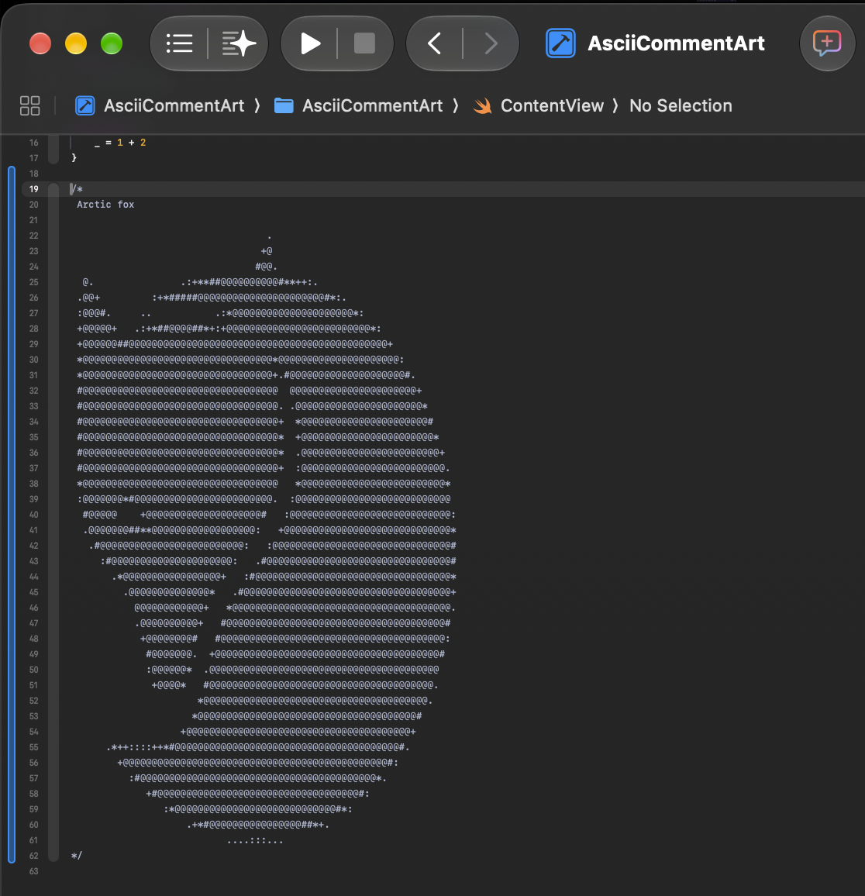

# AsciiCommentArt 🦊

[English](#english) · [繁體中文](#繁體中文)

[](AsciiCommentArt.xcodeproj/project.pbxproj)

<a id="english"></a>

## English

A small SwiftUI project featuring an arctic fox drawn with ASCII characters inside a Swift block comment. Open the source in Xcode to see the artwork alongside the code.

### 📸 Preview



The screenshot shows [ContentView.swift](AsciiCommentArt/ContentView.swift). The artwork lives in the source comment; running the app displays the starter “Hello, world!” view.

### Quick start

1. Clone the repository and open the Xcode project:

   ```sh
   git clone https://github.com/PeterPanSwift/AsciiCommentArt.git
   cd AsciiCommentArt
   open AsciiCommentArt.xcodeproj
   ```

2. Open `AsciiCommentArt/ContentView.swift` to view the fox.
3. To run the app, select the `AsciiCommentArt` scheme and a supported destination, then press **⌘R**. For a physical device, configure your signing team in Xcode.

Use a monospaced font and preserve the spaces and line breaks when copying or editing the artwork.

### Requirements

- macOS with Xcode and an SDK compatible with the selected destination.
- Current deployment targets: **iOS 27.0**, **macOS 27.0**, and **visionOS 27.0**.
- The source uses SwiftUI, `#Preview`, and the Playgrounds `#Playground` macro. No third-party dependencies are configured.

### Project layout

| Path | Purpose |
| --- | --- |
| [ContentView.swift](AsciiCommentArt/ContentView.swift) | Starter view, preview, playground, and arctic fox comment |
| [MyApp.swift](AsciiCommentArt/MyApp.swift) | SwiftUI app entry point |
| [AsciiCommentArt.xcodeproj](AsciiCommentArt.xcodeproj) | Xcode project and build settings |
| [docs/images](docs/images) | README screenshot |

[閱讀繁體中文版 ↓](#繁體中文)

---

<a id="繁體中文"></a>

## 繁體中文

一個小型 SwiftUI 專案，在 Swift 區塊註解中用 ASCII 字元畫出北極狐。用 Xcode 開啟原始碼，就能在程式碼旁欣賞這幅圖案。

### 📸 預覽


截圖顯示的是 [ContentView.swift](AsciiCommentArt/ContentView.swift)。圖案位於原始碼註解中；執行 App 時會顯示初始的「Hello, world!」畫面。

### 快速開始

1. 複製儲存庫並開啟 Xcode 專案：

   ```sh
   git clone https://github.com/PeterPanSwift/AsciiCommentArt.git
   cd AsciiCommentArt
   open AsciiCommentArt.xcodeproj
   ```

2. 開啟 `AsciiCommentArt/ContentView.swift`，即可查看北極狐圖案。
3. 若要執行 App，選擇 `AsciiCommentArt` scheme 與支援的執行目的地，再按 **⌘R**。在實體裝置上執行時，請在 Xcode 設定自己的簽署團隊。

複製或修改圖案時，請使用等寬字型，並保留空格與換行，維持圖案的排列。

### 環境需求

- 安裝 Xcode 的 macOS，以及與所選執行目的地相容的 SDK。
- 目前最低部署版本為 **iOS 27.0**、**macOS 27.0** 和 **visionOS 27.0**。
- 原始碼使用 SwiftUI、`#Preview` 和 Playgrounds 的 `#Playground` 巨集，未設定第三方相依套件。

### 專案結構

| 路徑 | 用途 |
| --- | --- |
| [ContentView.swift](AsciiCommentArt/ContentView.swift) | 初始畫面、預覽、playground 與北極狐註解 |
| [MyApp.swift](AsciiCommentArt/MyApp.swift) | SwiftUI App 進入點 |
| [AsciiCommentArt.xcodeproj](AsciiCommentArt.xcodeproj) | Xcode 專案與建置設定 |
| [docs/images](docs/images) | README 截圖 |

[Read in English ↑](#english)
